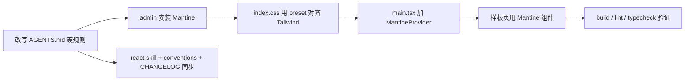

# 管理端引入 Mantine — 技术方案

输入：`docs/deliverables/20261124-admin-mantine/01-prd.md`。目标产出：admin 具备「Mantine 组件 + Tailwind 布局」共存能力，并有可复用的样板页与规范边界。

## 1. 现状

- `apps/admin`：Vite 8 + React 19 + TS 7 + Tailwind 4（`@tailwindcss/vite` 插件），端口 47174
- `src/main.tsx`：`createRoot` 渲染 `<StrictMode><App /></StrictMode>`，导入 `./index.css`
- `src/App.tsx`：纯 Tailwind 手写页面（health 探活状态 + todos 列表 + 加载/错误态），约 60 行
- `src/index.css`：仅 `@import "tailwindcss";`
- 依赖：只有 `@starter/api`、`@starter/shared`、`react`、`react-dom`，无 UI 组件库
- 硬规则：`templates/base/AGENTS.md` 第 16 行禁止前端引入第三方 UI 组件库

## 2. 可行性结论

| 功能 | 结论 | 依据 |
| --- | --- | --- |
| F1 改写硬规则 | 可做 | 纯文档改动，无技术风险 |
| F2 admin 接入 Mantine | 可做 | 官网 Vite 指南给出完整步骤；`tailwind-preset-mantine` v4 明确支持 Tailwind 4 + Mantine 9，一行 `@import` 解决 layer 顺序与主题对齐 |
| F3 样式分工规范 | 可做 | 纯文档；官方 FAQ 确认 Mantine 组件接受 `className` / `classNames`，可与 Tailwind 共存 |
| F4 规范同步 | 可做 | 纯文档改动 |
| F5 样板页 | 可做 | 现有页面约 60 行、结构清晰，替换 UI 表达不影响数据流（`api.health()` / `api.todos()` 不变） |

全部「可做」，无回退项。Q1/Q2/Q3 为 PRD 待确认问题，按默认假设实施。

## 3. 方案概述

只改管理端：依赖、样式入口、Provider、样板页；其它端不动。规则层面把「禁止第三方 UI 组件库」拆成分端约定，再把 Mantine 与 Tailwind 的分工写进规范。

## 4. 技术选型

| 选项 | 结论 | 理由 | 被否原因 |
| --- | --- | --- | --- |
| Mantine 9 | 选用 | 120+ 组件、原生 CSS 无运行时开销、Vite 一等支持、AI 工具链友好 | — |
| shadcn/ui | 否 | Tailwind 原生但需要把组件源码复制进仓库自行维护，与「不重复造轮子」初衷冲突 | 维护成本在自己 |
| Ant Design | 否 | 体积大、CSS-in-JS 运行时开销，定制体系重 | 与极简约定不符 |
| 继续手写 Tailwind | 否 | 管理端表单/弹窗/通知/日期等重复劳动多 | PRD 背景 |

## 5. 数据模型

无。本期不涉及数据库与 schema。

## 6. 接口契约

无新业务接口。样板页继续调用既有 `api.health()` / `api.todos()`，只换 UI 表达。

## 7. 模块与文件规划

| 文件 | 动作 | 职责 |
| --- | --- | --- |
| `templates/base/AGENTS.md` | 改 | 硬规则第 16 行改为分端约定 |
| `apps/admin/package.json` | 改 | 加 `@mantine/core`、`@mantine/hooks`；devDependencies 加 `tailwind-preset-mantine` |
| `apps/admin/src/index.css` | 改 | `@import "tailwindcss"` → `@import "tailwind-preset-mantine"` |
| `apps/admin/src/main.tsx` | 改 | 导入 `@mantine/core/styles.css`，包 `MantineProvider` |
| `apps/admin/src/App.tsx` | 改 | 样板页：Mantine 组件 + Tailwind 布局 |
| `skills/standards/react/SKILL.md` | 改 | 补 Mantine 接入与分工约定 |
| `docs/guides/conventions.md` | 改 | 新增「前端样式与组件库」类别 |
| `docs/CHANGELOG.md` | 改 | 记录本次变更 |

## 8. 关键流程

**安装与接入**：装包 → 改 `index.css` 用 preset → 入口导入 Mantine 样式 → `MantineProvider` 包裹应用根。

**写一个管理端页面**：判断控件类型 → 交互控件用 Mantine（Form/Table/Modal/Date/Notification 等）→ 布局与间距用 Tailwind（`className` 传入）→ 保持 `export const` 写法。

**异常分支**：
- 样式被 Tailwind 覆盖：检查 preset 是否生效、layer 顺序是否被破坏，不靠 `!important` 硬压
- 需要 Mantine 主题 mixins（light/dark/rtl）：按官网补 `postcss-preset-mantine`，本期样板页不需要
- 其它端误引入 Mantine：规则层面禁止，review 时检查各端 `package.json`

## 9. 安全与权限

无新增安全面。沿用既有约定：接口走 `@starter/api`，不自己写 fetch；不硬编码域名。

## 10. 兼容与迁移

- **Tailwind preflight 冲突**：Prisma 之外的技术风险集中在这里。采用 `tailwind-preset-mantine` 的 `@layer theme, base, mantine, components, utilities;` 方案，让 Mantine 样式不参与 Tailwind reset，同时对齐 `mantine-color-*` / `color-*`、`mantine-spacing-*` / `spacing-*` 变量
- **不装 PostCSS 插件**：官网 Vite 指南的 `postcss-preset-mantine` 用于 CSS Modules 的 mixins；本期用 preset + Tailwind，样板页不需要 mixins，保持配置最小
- **断点差异**：由 preset 统一，不手动改 Tailwind 断点
- **client / portal**：完全不动，规则明确它们不引入组件库

## 11. 任务拆分

| 编号 | 任务 | 涉及文件 | 依赖 | 验收方式 |
| --- | --- | --- | --- | --- |
| T1 | 改写硬规则 | `AGENTS.md` | — | 规则改为分端约定，client/portal 仍禁止 |
| T2 | 安装与接入 Mantine | admin/package.json、index.css、main.tsx | T1 | 依赖就位、Provider 包裹、样式导入、preset 生效 |
| T3 | 样式分工规范 | react skill、conventions、CHANGELOG | T1 | 三处全部命中 |
| T4 | 样板页改写 | admin/src/App.tsx | T2 | 用 Mantine 组件渲染，保留 health/todos/加载/错误态 |
| T5 | 静态验证 | — | T1-T4 | `pnpm build` / `pnpm lint` / `pnpm typecheck` 通过；client/portal 依赖不变 |

## 12. 风险

| 风险 | 触发条件 | 应对 |
| --- | --- | --- |
| 两套样式层冲突 | Tailwind preflight 覆盖 Mantine 组件样式 | 用 preset 的 layer 顺序；不用 `!important` 硬压 |
| 依赖体积膨胀 | 一次性装全部 Mantine 扩展 | 只装 `@mantine/core` + `@mantine/hooks`，其余按需 |
| 其它端误用 | 规则放宽后被误解为全端可用 | AGENTS.md 与 conventions 都写明只限 admin，review 检查各端 package.json |
| 版本漂移 | `latest` 指向不兼容版本 | 显式锁 Mantine 9.x、preset 4.x |
