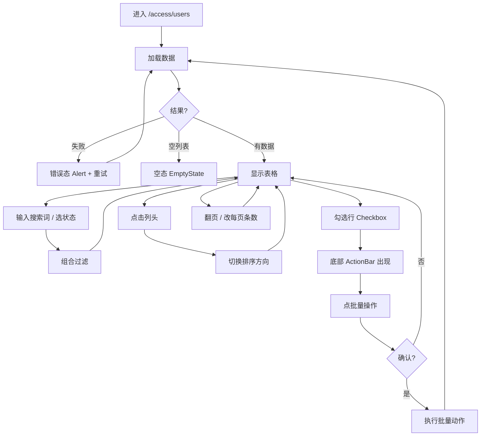
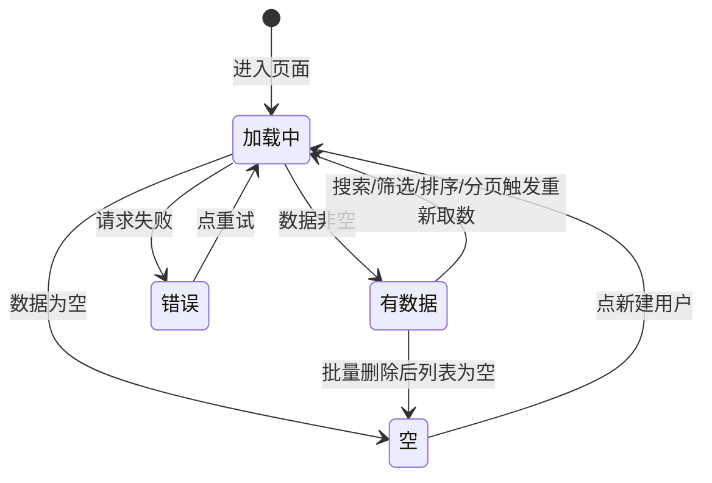

# 管理端数据表格 — 交互稿（页面怎么联动）

> 与 `01-prd.md` 的 F1–F6 对应。本期前端静态数据，所有交互在客户端完成。

## 1. 主流程（Mermaid）

## 2. 状态机（F6，Mermaid）

同一时刻只处于一个状态；状态切换必须经由「加载中」，避免直接跳变。

## 3. 交互明细

| 编号 | 交互 | 触发 | 行为 | 反馈 |
| --- | --- | --- | --- | --- |
| F2-1 | 关键词搜索 | 输入 / 清空 | 即时按邮箱或显示名过滤（静态数据） | 表格行与「共 N 条」同步更新 |
| F2-2 | 状态筛选 | 选择状态 | 与关键词组合过滤 | 表格行与总数更新 |
| F2-3 | 重置 | 点击 | 清空关键词、状态回「全部」、页码回 1 | 恢复完整数据 |
| F3-1 | 排序 | 点击可排序列头 | 升序 → 降序 → 取消（三态循环） | 箭头图标切换；仅一列有排序态 |
| F4-1 | 行选择 | 点击行 Checkbox | 选中/取消该行 | 行背景高亮；ActionBar 按选中状态显隐 |
| F4-2 | 全选 | 点击表头 Checkbox | 全选/取消当前页所有行 | 部分选中时表头显示 indeterminate |
| F4-3 | 批量操作 | 点 ActionBar 按钮 | 弹确认提示 | 见「文案」节；确认后执行并回到「加载中」 |
| F5-1 | 翻页 | 点页码 / 前后箭头 | 切换当前页 | 显示对应区间数据 |
| F5-2 | 每页条数 | 选择 10/20/50 | 更新每页条数 | 页码回 1，总数不变 |
| F6-1 | 重试 | 错误态点「重试」 | 重新进入「加载中」 | 成功/失败按状态机流转 |

## 4. 边界与异常

| 场景 | 处理 |
| --- | --- |
| 搜索无匹配 | 进入空态，提示「没有匹配的用户」，保留搜索词与「清空搜索」入口 |
| 连续快速输入 | 即时过滤，无需防抖（静态数据）；接真实 API 后再加防抖 |
| 全选后翻页 | 只选当前页；跨页选择留后续需求 |
| 批量删除后当前页为空且非第一页 | 自动回退到上一页 |
| 排序与筛选叠加 | 先过滤后排序，页码回 1 |

## 5. 文案

| 场景 | 文案 |
| --- | --- |
| 错误态标题 | 加载失败 |
| 错误态说明 | 无法获取用户数据，请稍后重试。 |
| 空态标题 | 暂无用户数据 |
| 空态说明 | 创建第一个用户后即可在此管理。 |
| 搜索空态 | 没有匹配的用户，试试调整搜索词或筛选条件。 |
| 批量删除确认 | 确定删除选中的 {n} 个用户？此操作不可撤销。 |
| 批量启用确认 | 确定启用选中的 {n} 个用户？ |
| 批量停用确认 | 确定停用选中的 {n} 个用户？停用后无法登录。 |

## 6. 无障碍与键盘

- Checkbox 有 `aria-label`（如「选择张三」）
- 列头排序按钮可用 Enter / Space 触发
- 错误提示用 `role="alert"`（Mantine `Alert` 默认处理）
- 表头与行使用语义化 `Table.Thead` / `Table.Tbody` / `Table.Th`

## 7. 编号对照

与 `01-prd.md`、`01-wireframe.md` 的 F1–F6 一致；本稿新增的 F2-1…F6-1 为交互细则编号，不改动功能编号。

## 8. 底座约束（借鉴 clinic-desk data-list，仅理念）

| 约束 | 说明 |
| --- | --- |
| 筛选区受控 | 组件不持有值、不发请求；`onChange` 回传完整筛选值，由页面决定过滤（本期静态数据即时过滤） |
| 页数单一来源 | 总页数只在一处推导（`ceil(total/pageSize)`），`Pagination` 与翻页边界共用同一值，杜绝「页码可点但被拒绝」 |
| 双视图独立状态 | 桌面筛选卡片与移动芯片行两套 DOM 同时渲染、各自持有面板开合态，不跨断点共享 |
| 文案可配置 | 错误 / 空态 / 确认文案走常量，不硬编码在组件内部；由页面按场景注入 |
| 业务页职责收窄 | 页面只提供列定义、筛选配置、数据；四态切换 / 分页 / 选中由 `DataTable` 底座统一处理 |
| 取数函数化 | 后续接 API 时 `queryOptions(page, pageSize)` 为函数，页码变化时重新取数；本期静态数据由底座内部分页 |
| 泛型靠推断 | `useDataTable` 靠 `getRowKey` 参数标注推断行类型，调用处不显式写泛型 |
| 选中集合通用 | `selected` 为 `Set<string \| number>`，不绑定具体业务主键；本期用户页用 `string` |
| 零后端结构假设 | 四态判定 / 取数 / 取总数可注入；接口形态不同时逐个覆盖，不改组件 |

> 借鉴的是设计原则，不照搬 clinic-desk 医生端的自研组件实现；本模板用 Mantine 组件库落地。
