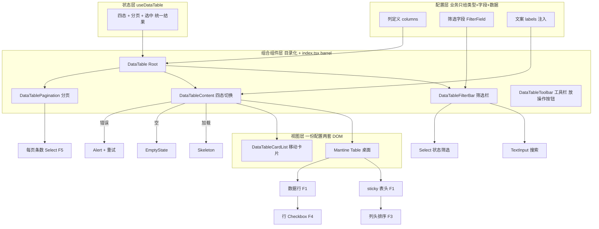

# 管理端数据表格 — 线稿（页面上显示什么）

> 与 `01-prd.md` 的 F1–F6 对应。只描述结构与内容，不做精细视觉。

## 1. 页面整体结构（用户管理页）

```text
┌──────────────────────────────────────────────────────────┐
│ 用户管理                                    [+ 新建用户] │  PageShell: title + 工具栏(操作区)
├──────────────────────────────────────────────────────────┤
│ 🔍 搜索用户…   [状态: 全部 ▾]   [重置]                  │  F2 筛选栏
├──────────────────────────────────────────────────────────┤
│ ☐ │ 用户      │ 邮箱           │ 角色  │ 状态 │ 创建时间 │ 操作 │  F1 sticky 表头
│───┼───────────┼────────────────┼───────┼──────┼──────────┼─────│
│ ☐ │ 👤 张三   │ zhang@ex.com   │ admin │ ●正常│ 11-24    │ 编辑 删除 │  F1 数据行
│ ☐ │ 👤 李四   │ li@ex.com      │ member│ ○禁用│ 11-23    │ 编辑 删除 │
│ … │ …         │ …              │ …     │ …    │ …        │ …        │
├──────────────────────────────────────────────────────────┤
│ 共 25 条   [每页 10 ▾]      [‹] [1] [2] [3] [›]          │  F5 分页
├──────────────────────────────────────────────────────────┤
│ （选中行时浮出）[删除] [启用] [停用]   已选 2 项          │  F4 ActionBar 固定底栏
└──────────────────────────────────────────────────────────┘
```

## 2. 组件树（Mermaid）



> 四层结构借鉴 clinic-desk `components/data-list`，用 Mantine 组件库落地，不照搬其自研代码。

## 3. 各区域内容

### 3.1 PageShell（页面壳）

- title：`用户管理`；description：`管理系统用户与角色分配`（可选）
- 工具栏（页面操作区）：右侧 `+ 新建用户` 按钮（本期点击仅占位提示，不实现表单）
- **术语**：工具栏放操作按钮（新建/导入/导出）；筛选栏放搜索与过滤条件（见 3.2），两者不混用

### 3.2 筛选栏（F2）

| 控件 | 类型 | 内容 |
| --- | --- | --- |
| 关键词 | `TextInput` | placeholder「搜索用户…」，左侧搜索图标，可清空 |
| 状态 | `Select` | 选项：全部 / 正常 / 禁用，默认「全部」 |
| 重置 | `Button variant=subtle` | 清空搜索词与筛选 |

### 3.3 表格（F1 / F3 / F4）

用户页列定义（其它页按域调整）：

| 列 | 宽度 | 内容 | 可排序 |
| --- | --- | --- | --- |
| 选择 | 48px | `Checkbox` | 否 |
| 用户 | 200px | Avatar + 显示名 | 否 |
| 邮箱 | 240px | 文本 | 是 |
| 角色 | 120px | `Badge` | 否 |
| 状态 | 100px | `Badge`（正常绿 / 禁用灰） | 是 |
| 创建时间 | 140px | `YYYY-MM-DD` | 是 |
| 操作 | 120px | 编辑 / 删除 文本按钮 | 否 |

- 表头 `stickyHeader`；外层 `Table.ScrollContainer minWidth=900 maxHeight=520`
- 选中行背景 `var(--mantine-color-blue-light)`

### 3.4 分页（F5）

- 左：`共 N 条` + `每页 [10/20/50]`
- 右：`Pagination`（总页数 = ceil(N / 每页条数)）

### 3.5 批量操作条（F4）

- 选中任意行后，页面底部浮出 Mantine `ActionBar`（固定底栏）
- 内容：`已选 {n} 项` + 按钮组「批量删除 / 批量启用 / 批量停用」
- 未选中任何行时 ActionBar 不显示（不占位）

## 4. 状态视图（F6，四选一）

| 状态 | 显示 | 不显示 |
| --- | --- | --- |
| 加载 | 5 行 `Skeleton`，保持列宽 | 表格数据、空态、错误 |
| 空 | `EmptyState`：标题「暂无用户数据」+ 说明 + 「新建用户」按钮 | Skeleton、表格行、错误 |
| 错误 | `Alert color=red`：标题「加载失败」+ 错误文案 + 「重试」按钮 | Skeleton、表格行、空态 |
| 有数据 | 表格 + 分页 | 其余三种 |

## 5. 响应式

- 宽屏：筛选栏单行，表格固定列宽
- 窄屏（< 48em）：筛选栏换行，表格横向滚动（`ScrollContainer`），分页换行

## 6. 编号对照

F1 表格 / F2 搜索筛选 / F3 排序 / F4 选择批量 / F5 分页 / F6 状态——与 `01-prd.md`、`01-interaction.md` 一致。

## 7. 双视图（借鉴 clinic-desk，仅理念）

同一份数据、两种视图，CSS 断点切换（DOM 同时存在，只显示一套）：

| 断点 | 视图 | 说明 |
| --- | --- | --- |
| 桌面（≥48em） | 上述表格 | 列定义驱动，sticky 表头，横向滚动兜底 |
| 移动（<48em） | `DataTableCardList` 卡片列表 | 每张卡展示「用户 / 邮箱 / 角色 / 状态 / 创建时间」，首部 Checkbox；不横向滚动 |

筛选同样双形态：桌面为筛选卡片（搜索框 + inline 控件 + 已选条件行），移动为芯片行（inline 控件芯片 + 筛选抽屉）。两份布局各自持有面板开合态，不跨断点共享。

> 只借鉴「一份配置两套视图」的理念；本模板用 Mantine 组件库实现，不引入 clinic-desk 的自研 `DataList` 代码。
