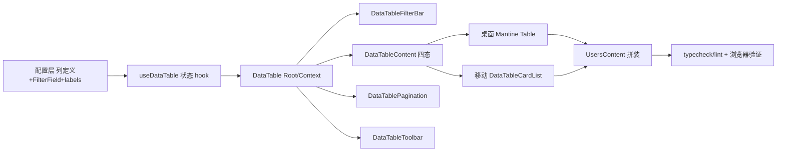

# 管理端数据表格（Table）— 技术方案

输入：`01-prd.md`（F1–F6 + 已确认的 Q1–Q4 + 第 10/11 节的 data-list 理念与组件命名）。目标产出：可复用的 `DataTable` 组件 + 用户管理页样板，7 条路由中的 `/access/users` 从占位变为真实列表。

## 1. 现状

- `apps/admin` 用户/角色/租户/权限页均为 `PlaceholderContent` 占位（`features/access/users/UsersContent.tsx` 等）
- 路由已就位：`routes/access/users.tsx` → `/access/users`；`routeTree.gen.ts` 为生成物
- 已有 Mantine 9（core/hooks）、Tabler 图标、`tailwind-preset-mantine`、`PageShell` 组件、`@/*` 路径别名（tsconfig + vite.config 双配置）
- 无数据表格组件；无 TanStack Query（本期静态数据，不引入）

## 2. 可行性结论

| 功能 | 结论 | 依据 |
| --- | --- | --- |
| F1 表格基础 | 可做 | Mantine `Table` 提供 `stickyHeader`、`ScrollContainer`、`highlightOnHover`、`tabularNums`、行选择示例；列定义驱动可行 |
| F2 搜索与筛选 | 可做 | Mantine `TextInput` / `Select` 已装；配置化 `FilterField` 为纯 TS 类型，无新依赖 |
| F3 排序 | 可做 | 静态数据客户端排序，三态循环为组件内部 state |
| F4 行选择与批量 | 可做 | Mantine `Checkbox` + `ActionBar` 官方组件，本期确认弹窗用 `Modal`（无需引入新库） |
| F5 分页 | 可做 | Mantine `Pagination` 已提供；页数单一来源在 `functions.ts` 一处推导 |
| F6 状态表达 | 可做 | Mantine `Skeleton` / `EmptyState` / `Alert` 均为内置组件 |

全部「可做」，无回退项。Q1–Q4 已逐项确认（用户页样板 / 即时过滤 / ActionBar / 每页 10 条）。

## 3. 方案概述



四层借鉴 clinic-desk `components/data-list`，用 Mantine 组件库落地，不照搬其自研代码。

## 4. 技术选型

| 选项 | 结论 | 理由 | 被否原因 |
| --- | --- | --- | --- |
| Mantine 内置 `Table` + 组合封装 | 选用 | 官方组件、无新依赖、`stickyHeader`/`ScrollContainer`/行选择齐备 | — |
| `mantine-datatable` | 否 | 第三方库，违反「不引入第三方 DataTable」约定 | 增加依赖与维护成本 |
| clinic-desk 自研 `DataList` 代码 | 否 | 那是自研体系，本项目用组件库 | 技术路线不同 |
| 手写 `<table>` | 否 | 重复劳动，无主题/可访问性 | 违背复用原则 |

## 5. 数据模型

本期无数据库变更。静态数据结构（用户页）：

```ts
type UserRow = {
  id: string;
  name: string;
  email: string;
  role: 'admin' | 'member';
  status: 'active' | 'disabled';
  createdAt: string; // YYYY-MM-DD
};
```

`useDataTable<TRow>` 泛型化，靠 `getRowKey` 参数标注推断行类型，不 import 业务类型。

## 6. 接口契约

无新后端接口。本期静态数据由 `functions.ts` 内部完成过滤 / 排序 / 分页。后续接 API 时 `queryOptions(page, size)` 可注入，不改组件。

## 7. 模块与文件规划

| 文件 | 动作 | 职责 |
| --- | --- | --- |
| `apps/admin/src/components/DataTable/index.tsx` | 新增 | barrel，只 re-export `DataTable` 及组合原子 |
| `apps/admin/src/components/DataTable/DataTable.tsx` | 新增 | Root + Context，收 `columns` / `filters` / `labels` / `data` |
| `apps/admin/src/components/DataTable/DataTableFilterBar.tsx` | 新增 | 筛选栏（搜索 / 状态筛选 / 重置），配置驱动 |
| `apps/admin/src/components/DataTable/DataTableContent.tsx` | 新增 | 四态切换 + `emptyWhen` 覆盖 |
| `apps/admin/src/components/DataTable/DataTableTable.tsx` | 新增 | 桌面表格视图（rows + columns，sticky 表头，行选择） |
| `apps/admin/src/components/DataTable/DataTableCardList.tsx` | 新增 | 移动卡片视图（一份配置两套 DOM） |
| `apps/admin/src/components/DataTable/DataTablePagination.tsx` | 新增 | 分页 + 每页条数，页数读 Context 单一来源 |
| `apps/admin/src/components/DataTable/DataTableToolbar.tsx` | 新增 | 工具栏（新建 / 导入 / 导出操作按钮） |
| `apps/admin/src/components/DataTable/useDataTable.ts` | 新增 | 状态 hook：四态 + 分页 + 选中，`selected` 为 `Set<string\|number>` |
| `apps/admin/src/components/DataTable/functions.ts` | 新增 | 纯函数：四态判定 / 过滤 / 排序 / 分页推导 / 筛选芯片，可单测 |
| `apps/admin/src/components/DataTable/filter-fields.ts` | 新增 | `FilterField` 类型与配置构造 |
| `apps/admin/src/components/DataTable/types.ts` | 新增 | 列定义 / 筛选字段 / Context 类型 |
| `apps/admin/src/components/DataTable/labels.ts` | 新增 | 文案常量（错误 / 空态 / 确认），不 import i18n |
| `apps/admin/src/features/access/users/UsersContent.tsx` | 改 | 从占位改为拼装 `<DataTable>`，只给列定义 + 筛选配置 + 静态数据 |
| `apps/admin/src/features/access/users/UsersPage.tsx` | 不改 | 仍用 `PageShell` 包一层（「页面 = 壳 + 内容」） |
| `docs/deliverables/20261126-admin-table/` | 改 | 各阶段文档（已完成 PRD 三件套 + 本技术方案） |

## 8. 关键流程

**写新列表页**：在 `features/<域>/<Xxx>Content.tsx` 定义列 + 筛选字段 + 数据 → `<DataTable columns filters data labels>` → 完成；不写四态分支、不手写 `<table>`。
**四态**：`useDataTable` 产出 `state`，`DataTableContent` 内部切；`emptyWhen` 可由业务覆盖（处理「原始数据非空但派生后为空」）。
**分页**：`functions.ts` 一处推导总页数，`DataTablePagination` 与翻页边界共用同一值。
**双视图**：桌面 `DataTableTable` 与移动 `DataTableCardList` 同 DOM 渲染、CSS 断点切换；筛选面板 / 抽屉各自持有开合态，不跨断点共享。
**异常分支**：
- 搜索无匹配 → `emptyWhen` 判空进空态，保留搜索词与「清空搜索」入口
- 批量删除后当前页为空且非第一页 → 自动回退上一页
- 排序与筛选叠加 → 先过滤后排序，页码回 1

## 9. 安全与权限

无新增安全面。本期不做行级权限（PRD 非目标），所有数据对用户可见；接口仍走 `@starter/api`（本期静态数据不经过它）。

## 10. 兼容与迁移

- **与现有页面**：只改 `UsersContent.tsx`，`UsersPage.tsx` / 路由 / `PageShell` 不动；其它三个权限页继续占位，后续照搬本模式
- **与 Mantine Provider**：`DataTable` 在 `MantineProvider` 内层，主题变量正常继承
- **生成物**：`routeTree.gen.ts` 由插件生成，本需求不改路由，无需重新生成
- **后续接 API**：`queryOptions(page, size)` 注入点已在 hook 设计里预留，本期不接

## 11. 任务拆分

| 编号 | 任务 | 涉及文件 | 依赖 | 验收方式 |
| --- | --- | --- | --- | --- |
| T1 | 纯逻辑层 | `functions.ts`、`filter-fields.ts`、`types.ts` | — | 纯函数可单测；过滤/排序/分页推导正确 |
| T2 | 状态 hook | `useDataTable.ts` | T1 | 产出四态 + 分页 + 选中，`selected` 为 Set |
| T3 | 组合组件 | `DataTable.tsx` + FilterBar/Content/Pagination/Toolbar + index.tsx | T1,T2 | Context 打通，原子可独立使用 |
| T4 | 双视图 | `DataTableTable.tsx`、`DataTableCardList.tsx` | T3 | 桌面表格 + 移动卡片，断点切换 |
| T5 | 用户页样板 | `UsersContent.tsx` | T4 | 占位替换为真实列表，列定义驱动 |
| T6 | 验证 | — | T1-T5 | typecheck / lint / build（避开 OOM）+ ego-browser 视觉 |

## 12. 风险

| 风险 | 触发条件 | 应对 |
| --- | --- | --- |
| 本机内存不足导致全量 build OOM | Rolldown 阶段模块峰值高 | typecheck / lint 单独跑；build 在高内存环境重跑（已多次记录，非代码问题） |
| 组件名与 Mantine `Table` 混淆 | `DataTable` 与 `Table` 并存 | 文档明确 `DataTable` 是业务封装、`Table` 是 Mantine 原子；导入都走 barrel |
| 双 DOM 状态串扰 | 桌面/移动共用面板开合态 | 两套 DOM 各自持有 state（clinic-desk 约定），不跨断点共享 |
| 页数计算两处不一致 | 分页组件另算 `ceil(total/pageSize)` | 只从 `functions.ts` 一处推导，杜绝死按钮 |
