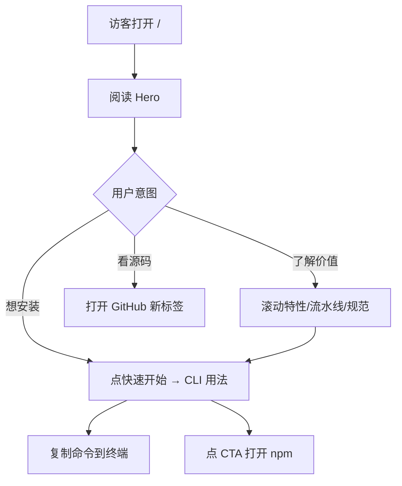

# yyx-agent-kit 门户站 · 交互说明

## 1. 全局规则

| 编号 | 规则 |
| --- | --- |
| G1 | 全站默认 Server Component，不引入客户端交互状态 |
| G2 | 页面内锚点跳转用原生 `<a href="#...">`，平滑滚动交给 CSS |
| G3 | 外链（GitHub / npm）新标签打开，`rel="noopener noreferrer"` |
| G4 | 终端命令块可手动选中复制，不实现「一键复制」按钮（避免客户端 JS） |

## 2. 交互明细

| 编号 | 触发 | 动作 | 目标 / 结果 | 异常分支 |
| --- | --- | --- | --- | --- |
| I1 | 点导航「特性 / 工作流 / 规范 / FAQ」 | 页内锚点跳转 | 滚动到对应区块 | — |
| I2 | 点 Hero「快速开始」 | 锚点跳转 | 到 W6 CLI 用法 | — |
| I3 | 点「查看源码」/ 导航 GitHub | 外链跳转 | 打开 GitHub 仓库新标签 | 新标签被拦截时保持当前页 |
| I4 | 点 CTA「pnpm dlx yyx-agent-kit」 | 外链跳转 | 打开 npm 包页面新标签 | 同上 |
| I5 | 移动端点 Logo | 锚点跳转 | 回到页首 | — |

## 3. 页面流程

## 4. 状态可见性

| 状态 | 可见 | 说明 |
| --- | --- | --- |
| 桌面 | 完整导航 + 多列栅格 | 宽屏布局 |
| 移动 | Logo + GitHub；单列 | 锚点隐藏，内容仍全部可达（通过滚动） |

## 5. 边界与异常

| 编号 | 场景 | 处理 |
| --- | --- | --- |
| E1 | 外链打不开 | 不影响本站，用户可复制地址 |
| E2 | 终端块窄屏溢出 | `overflow-x-auto`，不破坏页面宽度 |
| E3 | 锚点目标不存在 | 不发生——目标区块固定存在 |

## 6. 埋点建议

本期静态门户无埋点。

## 7. 待确认问题

| 编号 | 问题 | 默认假设 | 影响面 |
| --- | --- | --- | --- |
| IQ1 | 是否加「一键复制」按钮 | 不加，避免客户端 JS | G4 |
| IQ2 | 外链是否 noopener | 是 | G3 |
