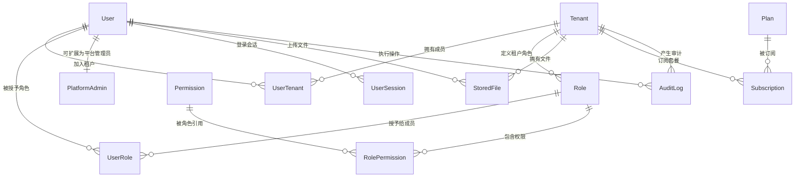

# 账号 / 租户 / 员工模型

> 结论：当前没有独立的「员工」实体。一个员工对应：
>
> - `User`：全局登录账号（邮箱、密码、状态）
> - `UserTenant`：这个账号属于哪个租户、在租户内是否启用
> - `UserRole`：这个账号在当前租户内拥有哪些角色
>
> 一个账号可以属于多个租户；角色和权限按租户隔离，登录态是全局的。

## 1. 实体关系



### 实体职责

| 实体 | 作用 | 关键字段 |
| --- | --- | --- |
| `User` | 全局身份，一个人一个账号 | `email` 唯一、`passwordHash`、`status` |
| `Tenant` | 租户 / 企业 | `slug` 唯一、`status`、`deletedAt` |
| `UserTenant` | 账号与租户的成员关系，也就是当前的「员工关系」 | `userId + tenantId` 联合主键、`status`、`joinedAt` |
| `Role` | 租户内角色 | `tenantId + code` 唯一、`isSystem` |
| `Permission` | 全局权限点 | `code` 唯一，如 `file:write` |
| `UserRole` | 成员在租户内被授予的角色 | `userId + roleId` 联合主键 |
| `RolePermission` | 角色包含的权限点 | `roleId + permissionId` 联合主键 |
| `PlatformAdmin` | 平台运营人员，`User` 的 1:1 扩展 | `level: super / ops` |
| `UserSession` | 登录设备 / 服务端会话 | `id` 为 SHA-256，JWT 里带 `sid` |
| `StoredFile` | 租户文件元数据 | `tenantId`、`uploadedById` |
| `Plan` / `Subscription` | 套餐与租户订阅 | `Plan.code`、`Subscription.tenantId` |
| `AuditLog` | 关键操作审计 | `tenantId` 可空（平台操作为空） |

## 2. 管理员建账号链路

```mermaid
flowchart TD
  PA[平台管理员] -->|POST /users| U[创建全局账号 User]
  PA -->|POST /tenants| T[创建租户 Tenant]
  T --> R[自动初始化 admin / member 角色]
  R --> P[绑定权限点 Permission]
  PA -->|initialAdminEmail| UT[写入 UserTenant + UserRole]
  PA -->|POST /tenants/:tenantId/members| UT
  U --> UT
  UT -->|分配角色| UR[UserRole]

  TA[租户管理员] -->|登录| S[UserSession]
  S -->|Bearer JWT| API[/t/:tenantId/*]
  TA -->|添加已有账号 / 改角色| UT
```

### 当前实际限制

- **平台管理员**负责创建全局账号：`POST /users`
- **平台管理员**创建租户：`POST /tenants`，可传 `initialAdminEmail` 直接把一个已存在账号设为租户管理员
- **租户管理员**可以在自己的租户里按邮箱添加**已存在的全局账号**，并分配角色
- **租户管理员不能创建新的全局账号**，因为用户表是平台级资源
- 目前没有邀请邮件 / 自助注册；账号必须先由平台管理员创建

## 3. 请求鉴权与数据隔离链路

```mermaid
sequenceDiagram
  participant U as 用户
  participant M as TenantMiddleware
  participant G as TenantMembershipGuard
  participant DB as PostgreSQL
  participant S as Service

  U->>M: GET /t/:tenantId/files + Bearer JWT
  M->>M: 解析 URL 中的 tenantId，写入请求上下文
  M->>G: 继续执行
  G->>DB: 查 UserTenant（用户、租户、成员均 active）
  G->>DB: 查 UserRole + RolePermission（限定 role.tenantId）
  G-->>G: 计算 role / permissions，写入 req.membership
  G->>S: 放行
  S->>DB: BEGIN; set_config('app.tenant_id', tenantId, true)
  DB-->>S: RLS 只返回当前租户数据
  S-->>U: 200
```

拦截点：

1. `TenantMembershipGuard` 管人：账号必须是该租户的 active 成员
2. `@RequirePermission` 管操作：角色权限并集必须包含所需权限点
3. `Prisma scoped` 管资源：租户表禁止走全局客户端
4. PostgreSQL RLS 兜底：即使应用层漏过滤，数据库也只返回 `app.tenant_id` 对应的行

## 4. 当前「员工」模型的缺口

当前 `UserTenant` 只有：

```text
userId, tenantId, status, joinedAt
```

所以它只能表达「这个账号是不是这个租户的成员」，不能表达员工资料。

如果 SaaS 需要以下字段，建议扩展模型：

| 需求 | 建议 |
| --- | --- |
| 工号、职位、手机号、部门 | 给 `UserTenant` 增加字段，或新增 `TenantMemberProfile` 1:1 扩展 |
| 一个账号在不同租户显示不同姓名/职位 | 必须放到租户侧，不能只放在全局 `User.displayName` |
| 部门树 / 组织架构 | 新增 `TenantDepartment`，成员关联部门 |
| 邀请人 / 入职来源 | 给 `UserTenant` 增加 `invitedById`、`joinedAt` 等 |
| 员工离职 | 把 `UserTenant.status` 改为 suspended，保留历史角色与审计 |

推荐先保持简单：

- 如果只是「管理员建账号 → 加入租户 → 分配角色」，当前模型已经够用
- 如果要做员工档案 / 组织架构，再引入 `TenantMemberProfile` 和 `TenantDepartment`，不要继续把 HR 字段堆进 `User`

## 5. 一句话总结

**账号是全局的，员工关系是租户的，角色是租户内的，权限点是全局定义的。**  
当前链路可以支持「平台管理员建账号、租户管理员加成员、按角色控制功能」，但还不支持邀请注册和员工档案。

## 6. 本地演示账号

运行：

```bash
pnpm --filter @starter/server db:seed:demo
```

会创建平台超管、平台运维、租户管理员、普通成员、文件管理员、多租户用户、停用成员、禁用账号，统一密码 `demo_pwd_2026`。完整清单见 `docs/guides/credentials.md`。

租户管理员登录后可以通过「权限管理 → 成员」管理当前租户成员与角色。
